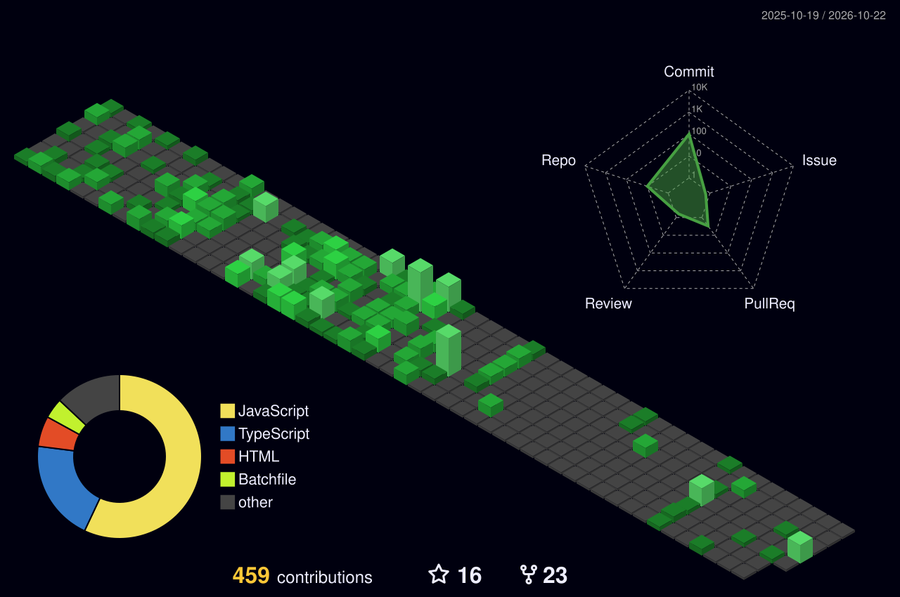

<!-- ===================== HEADER ===================== -->
<p align="center">
  
</p>

<p align="center">
  <a href="https://github.com/omar00050">
    
  </a>
</p>

<p align="center">
  <a href="https://github.com/omar00050?tab=followers"></a>
  
  <a href="https://wakatime.com/@farghaly"></a>
</p>

<p align="center">
  <a href="https://farghaly.dev"></a>
  <a href="mailto:omar@farghaly.dev"></a>
</p>

---

## 👨‍💻 About Me

<table>
<tr>
<td width="60%" valign="top">

I'm **Omar**, a **23-year-old Full-Stack Developer** from **Egypt 🇪🇬** focused on **backend systems and scalable web platforms**.

- 🏗️ I design and build **backend systems & microservices** with **Node.js** — clean architecture, APIs and services that scale.
- 🌐 I build **full web platforms** end-to-end, from dashboards and internal systems to **e-commerce stores**.
- 🔭 Currently working on **DevXor-v5** &nbsp;
- 🤖 I still build **Discord bots** and automation tools on the side.
- 💬 Ask me about **Node.js, system design, microservices, REST APIs, Next.js**.
- 📫 Reach me at **omar@farghaly.dev**

</td>
<td width="40%" align="center" valign="middle">

<a href="https://discord.com/users/768414261231747093">
  
</a>

</td>
</tr>
</table>

---

## 🧰 Tech Stack

<table align="center">
<tr>
<td align="center" width="50%">
  <b>💻 Languages</b><br/><br/>
  
</td>
<td align="center" width="50%">
  <b>🗄️ Backend & Databases</b><br/><br/>
  
</td>
</tr>
<tr>
<td align="center">
  <b>🎨 Frontend</b><br/><br/>
  
</td>
<td align="center">
  <b>🛠️ Tools</b><br/><br/>
  
</td>
</tr>
<tr>
<td align="center" colspan="2">
  <b>☁️ DevOps & Cloud</b><br/><br/>
  
</td>
</tr>
</table>

---

## 📊 GitHub Stats

<table align="center">
<tr>
<td align="center">
  
</td>
<td align="center">
  
</td>
</tr>
<tr>
<td align="center">
  
</td>
<td align="center">
  
</td>
</tr>
</table>

<h3 align="center">📈 My Coding Habits</h3>

<!--START_SECTION:habits-->
**🐱 My GitHub Data** 

> 📦 367.5 kB Used in GitHub's Storage 
 > 
> 🏆 372 Contributions in the Year 2026
 > 
> 🚫 Not Opted to Hire
 > 
> 📜 24 Public Repositories 
 > 
> 🔑 22 Private Repositories 
 > 
**I'm a Night 🦉** 

```text
🌞 Morning                93 commits          ██████░░░░░░░░░░░░░░░░░░░   24.28 % 
🌆 Daytime                91 commits          ██████░░░░░░░░░░░░░░░░░░░   23.76 % 
🌃 Evening                123 commits         ████████░░░░░░░░░░░░░░░░░   32.11 % 
🌙 Night                  76 commits          █████░░░░░░░░░░░░░░░░░░░░   19.84 % 
```
📅 **I'm Most Productive on Monday** 

```text
Monday                   90 commits          ██████░░░░░░░░░░░░░░░░░░░   23.50 % 
Tuesday                  56 commits          ████░░░░░░░░░░░░░░░░░░░░░   14.62 % 
Wednesday                89 commits          ██████░░░░░░░░░░░░░░░░░░░   23.24 % 
Thursday                 37 commits          ██░░░░░░░░░░░░░░░░░░░░░░░   09.66 % 
Friday                   43 commits          ███░░░░░░░░░░░░░░░░░░░░░░   11.23 % 
Saturday                 18 commits          █░░░░░░░░░░░░░░░░░░░░░░░░   04.70 % 
Sunday                   50 commits          ███░░░░░░░░░░░░░░░░░░░░░░   13.05 % 
```


📊 **This Week I Spent My Time On** 

```text
🕑︎ Time Zone: Africa/Cairo
```

**I Mostly Code in HTML** 

```text
HTML                     6 repos             ██████████░░░░░░░░░░░░░░░   40.00 % 
JavaScript               4 repos             ███████░░░░░░░░░░░░░░░░░░   26.67 % 
TypeScript               3 repos             █████░░░░░░░░░░░░░░░░░░░░   20.00 % 
Batchfile                2 repos             ███░░░░░░░░░░░░░░░░░░░░░░   13.33 % 
```


 Last Updated on 28/10/2026 18:01:25 UTC
<!--END_SECTION:habits-->

---

## 🧊 Contributions in 3D

<p align="center">
  <picture>
    <source media="(prefers-color-scheme: dark)" srcset="./profile-3d-contrib/profile-night-green.svg" />
    <source media="(prefers-color-scheme: light)" srcset="./profile-3d-contrib/profile-gitblock.svg" />
    
  </picture>
</p>

---

## 🛠️ What I Build

<table align="center">
<tr>
<td align="center" width="25%"><h3>🏗️</h3><b>Backend Systems</b><br/><sub>Robust APIs, auth, queues & business logic built to scale</sub></td>
<td align="center" width="25%"><h3>🧩</h3><b>Microservices</b><br/><sub>Independent services that communicate cleanly and deploy separately</sub></td>
<td align="center" width="25%"><h3>🌐</h3><b>Web Platforms</b><br/><sub>Full-stack apps, dashboards & e-commerce stores</sub></td>
<td align="center" width="25%"><h3>🤖</h3><b>Discord Bots</b><br/><sub>Tickets, moderation, dashboards & custom automation</sub></td>
</tr>
</table>

<p align="center">
  <a href="mailto:omar@farghaly.dev"></a>
  <a href="https://discord.com/users/768414261231747093"></a>
</p>

---

## ⏱️ This Week I Spent My Time On

<!--START_SECTION:waka-->

```txt
From: 20 October 2026 - To: 27 October 2026

Total Time: 4 hrs 37 mins

JavaScript   2 hrs 13 mins         ███████████▒░░░░░░░░░░░░░   45.14 %
Bash         40 mins               ███▒░░░░░░░░░░░░░░░░░░░░░   13.58 %
JSON         39 mins               ███▒░░░░░░░░░░░░░░░░░░░░░   13.51 %
TypeScript   18 mins               █▓░░░░░░░░░░░░░░░░░░░░░░░   06.31 %
Other        17 mins               █▓░░░░░░░░░░░░░░░░░░░░░░░   06.05 %
Prisma       15 mins               █▒░░░░░░░░░░░░░░░░░░░░░░░   05.40 %
```

<!--END_SECTION:waka-->

---

## 🔥 What I'm Working On

<table align="center">
<tr>
<td align="center" width="33%">
  <h3>⚙️</h3>
  <b>DevXor-v5</b><br/>
  <sub>The next version of DevXor — currently in active development</sub><br/><br/>
  
</td>
<td align="center" width="33%">
  <h3>🧩</h3>
  <b><a href="https://github.com/omar00050/DevXorHandler">DevXorHandler</a></b><br/>
  <sub>Command & event handler for Discord bots</sub><br/><br/>
  
</td>
<td align="center" width="33%">
  <h3>📻</h3>
  <b><a href="https://github.com/omar00050/quran_radio">quran_radio</a></b><br/>
  <sub>Quran radio streaming project</sub><br/><br/>
  
</td>
</tr>
</table>

---

## ⚡ Recent Activity

<!--START_SECTION:activity-->
_No recent public activity._
<!--END_SECTION:activity-->

---

## 🚀 Featured Projects

<p align="center">
  <a href="https://github.com/omar00050/DevXorHandler">
    
  </a>
  <a href="https://github.com/omar00050/quran_radio">
    
  </a>
</p>

---

## 🐍 Snake Eating My Contributions

<p align="center">
  <picture>
    <source media="(prefers-color-scheme: dark)" srcset="https://raw.githubusercontent.com/omar00050/omar00050/output/github-snake-dark.svg" />
    <source media="(prefers-color-scheme: light)" srcset="https://raw.githubusercontent.com/omar00050/omar00050/output/github-snake.svg" />
    
  </picture>
</p>

---

## 🤝 Connect With Me

<p align="center">
  <a href="https://www.linkedin.com/in/abofarghaly"></a>
  <a href="mailto:omar@farghaly.dev"></a>
  <a href="https://discord.com/users/768414261231747093"></a>
  <a href="https://twitter.com/farghaly00050"></a>
  <a href="https://www.instagram.com/farghaly00050/"></a>
</p>

<!-- ===================== FOOTER ===================== -->
<p align="center">
  
</p>

<p align="center">
  <i>⭐ If you like my profile, feel free to star the repo — and fork it if you want to use this template!</i>
</p>
